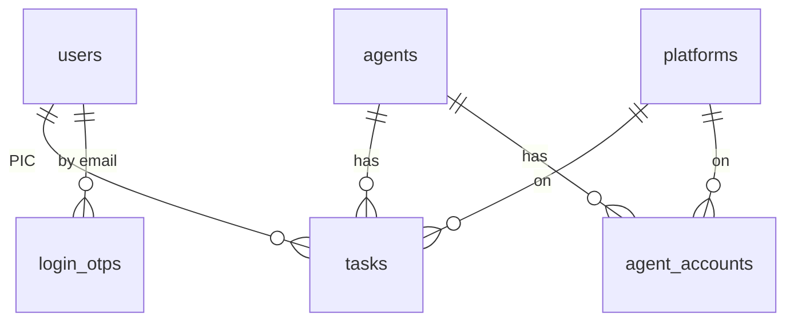

# KPI WEB GO4T

## OVERVIEW

Aplikasi internal Go4T untuk **tracking task harian agent**, **status agent**, **penilaian KPI karyawan**, dan **pusat data akun agent** (identifier + password per platform yang bisa dilihat/di-copy).

| Layer | Pilihan |
|-------|---------|
| Backend | Laravel 13.14, PHP 8.4 (fitur native dulu: Form Request, middleware, Scheduler, Mail) |
| Bridge | Inertia 2.0.24 — **tanpa REST API** (monolith), `HandleInertiaRequests` share `auth.user` |
| Frontend | Vue 3 Composition API `<script setup>`, JS (bukan TS), Vite 7 |
| UI | shadcn-vue (Reka UI) + `@lucide/vue`, komponen di `resources/js/Components/ui` |
| Style | **Tailwind murni** (v3), atomic, warisi dari parent |
| Chart | `chart.js` + `vue-chartjs` — **satu-satunya dependency baru** yg boleh ditambah |
| DB | MariaDB 10.6, `utf8mb4_unicode_ci`, InnoDB, migration = source of truth |
| Mail | SMTP cPanel (OTP + reset password), `QUEUE_CONNECTION=sync` |
| Hosting | cPanel, PHP 8.4.26, `APP_TIMEZONE=Asia/Jakarta`, build frontend **lokal** |

Dokumen sumber (dibaca sebelum kerja besar): `plan.md`, `ketentuan.md`, `step-by-step-id.md`, `specs-laravel.md`, `specs-environment.md`, `concept-kpi-web.md`, `concept.drawio.xml`.

Tiga role: `admin`, `user`, `auditor`.

## WHEN TO USE

Gunakan skill ini ketika:

- Menambah/mengubah fitur di project KPI Web: agent, agent account, platform, task, KPI, dashboard, user/role, auth (password/OTP).
- Membuat migration, model, cast, enum, Form Request, controller, komponen Vue, atau chart di project ini.
- Pertanyaan tentang formula KPI, level/target, atau periode penilaian.
- Deploy / troubleshooting di cPanel–MariaDB.

**Jangan pakai** untuk project Laravel lain atau stack berbeda — keputusan di bawah terikat ke project ini.

## PROCESS

### 0. Sebelum mulai

1. Baca `plan.md` (otoritatif) + dokumen sumber yg relevan; jangan berasumsi dari template lama.
2. Cek state nyata repo (`app/`, `routes/web.php`, `resources/js/Pages/`, `config/kpi.php`) sebelum mengklaim sesuatu sudah ada.
3. Tulis asumsi eksplisit bila requirement ambigu; berhenti dan tanya kalau bertentangan dengan plan.

### 1. Urutan kerja tiap fitur (wajib, tidak boleh lompat)

```text
route → controller → model → migration → test tinker → frontend sederhana (tanpa style) → test → styling → DONE
```

Tidak lanjut ke fitur berikutnya sebelum fitur sekarang lolos **Definition of Done** (lihat bagian Verification).

### 2. Roadmap fase

| Fase | Isi | DoD kunci |
|------|-----|-----------|
| F0 | Bersih-bersih template: Tailwind tetap v3 (hapus `@tailwindcss/vite`), Ziggy aktif (`@routes` di `app.blade.php`), `.env` lokal + `APP_TIMEZONE=Asia/Jakarta`, hapus route/halaman `register` + `verify-email`, branch `main`/`develop`/`feature/*` | `php artisan test` hijau, `npm run build` sukses, login tampil |
| F1 | Database foundation: modif `users` (role, is_active), `platforms`, `agents`, `agent_accounts`, `tasks`; model + relasi + cast (`encrypted`, enum) + Factory + Seeder | `php artisan migrate:fresh --seed` jalan; relasi sesuai ERD |
| F2 | Auth + role + `UserController` (admin kelola akun = use case REGISTER); middleware `EnsureRole` + alias; login password (cek `is_active`) + OTP | guest ditolak, role salah 403, OTP salah/expired/dipakai-ulang ditolak, throttle aktif; deploy staging awal + SMTP nyata + cron |
| F3 | CRUD agent + profile: `AgentController` (store/update/destroy/show), Form Request, `agent_accounts` ikut form, upload avatar (`image\|mimes:jpg,jpeg,png,webp\|max:2048`) | admin/user CRUD ok, auditor 403 saat mutasi, password tidak bocor di response list |
| F4 | Input task: `TaskController` + Form Request, filter tanggal/karyawan/agent/platform, pagination | task tersimpan lengkap; filter + pagination jalan |
| F5 | KPI (inti risiko, **dikerjakan sebelum dashboard**): `config/kpi.php` → `KpiCalculator` → tinker lawan sheet → test | angka identik dengan sheet untuk data uji sama; admin + auditor bisa, user 403 |
| F6 | Dashboard: 3 agregat chart, tabel agent (search/filter/sort A-Z/paginate), sel platform (identifier + copy + donut), ringkasan task per periode | angka chart cocok dengan query manual tinker; tidak ada N+1 (cek query log) |
| F7 | Responsive (desktop/tablet/mobile), empty/loading/error state, security review, performance, test integrasi per role | 3 breakpoint ok, tanpa `dd()`/`dump()`, `APP_DEBUG=false` |
| F8 | Production: backup DB → `git pull` → `composer install --no-dev -o` → upload `public/build` → `php artisan migrate --force` → `php artisan optimize` | login 2 metode, OTP mail, dashboard, KPI, upload, log, HTTPS, cron ok; backup+restore dites |

### 3. Keputusan mengikat (jangan dilanggar)

- **Tanpa REST API** — semua lewat Inertia page/controller.
- **Tailwind murni**: tidak ada custom CSS, `<style>`, `<style scoped>`, atau inline style.
- **Tailwind tetap v3** (selaras `tailwind.config.js` + `components.json`); `@tailwindcss/vite` (v4) tidak dipakai.
- Chart hanya lewat `chart.js` + `vue-chartjs`, dibungkus komponen reusable.
- **Enum**: PHP backed enum (`app/Enums`), kolom DB `string` (bukan kolom `enum`).
- **Password agent** pakai cast `'password' => 'encrypted'` (harus bisa ditampilkan + di-copy) — **jangan** `Hash::make`, dan **jangan ganti `APP_KEY` di production** setelah ada data (semua password agent jadi tidak terbaca).
- **Register hanya oleh admin**; route public register + email verification dihapus; route `dashboard` **tanpa** middleware `verified`.
- Route detail agent wajib `->whereNumber('agent')`, kalau tidak `/agents/create` ketangkap `{agent}`.
- `agents.index` tidak ada — daftar agent = tabel di dashboard.
- Target & status KPI di `config/kpi.php`, bukan hardcode di Vue.
- KPI dihitung **di backend oleh 1 service** (`KpiCalculator`), meniru formula Google Sheets.
- `QUEUE_CONNECTION=sync` (cPanel tidak menjamin worker); OTP dikirim langsung, bukan queue.
- Build frontend **lokal**, `public/build` di-upload (Node tidak dijamin ada di cPanel).

### 4. Role & permission

| Fitur | Admin | User | Auditor |
|-------|:-----:|:----:|:-------:|
| Login (password / OTP) | ✔ | ✔ | ✔ |
| Kelola user (register akun) | ✔ | – | – |
| Dashboard | ✔ | ✔ | ✔ |
| Lihat profile agent | ✔ | ✔ | ✔ |
| CRUD agent | ✔ | ✔ | – |
| Input / edit task | ✔ | ✔ | – |
| KPI | ✔ | – | ✔ |

`dashboard → CRUD agent → profile agent` bertipe `<<extend>>`: tombol `+ add` dan `edit` ada **di dalam** dashboard sebagai popup, bukan page terpisah.

Role `user` = karyawan lain yg butuh data akun platform: hanya boleh **melihat** data platform, copy `email`/`id`, dan melihat detail agent (nama, alamat, koordinat, deskripsi, email recovery, device, dll). Dia sendiri juga karyawan yg dinilai KPI, tapi **tidak bisa** membuka halaman KPI.

Authorization selalu **di backend** (middleware `role:` + validasi); menyembunyikan tombol di frontend cuma untuk UX.

### 5. Route & middleware

Page: `Auth/Login` `/login` (tab Password / Email OTP), `Auth/OtpVerify` `/login/otp`, `Dashboard` `/dashboard`, `Kpi/Index` `/kpi`, `Tasks/Index` `/tasks`, `Users/Index` `/users`, `Profile/Edit` `/profile`. `/` redirect ke `/dashboard`.

```php
<?php

use App\Http\Controllers\AgentController;
use App\Http\Controllers\DashboardController;
use App\Http\Controllers\KpiController;
use App\Http\Controllers\ProfileController;
use App\Http\Controllers\TaskController;
use App\Http\Controllers\UserController;
use Illuminate\Support\Facades\Route;

Route::redirect('/', '/dashboard');

// semua role
Route::middleware(['auth', 'role:admin,user,auditor'])->group(function () {
    Route::get('/dashboard', DashboardController::class)->name('dashboard');
    // whereNumber wajib, kalo ngga /agents/create ketangkep {agent}
    Route::get('/agents/{agent}', [AgentController::class, 'show'])
        ->whereNumber('agent')->name('agents.show');

    Route::get('/profile', [ProfileController::class, 'edit'])->name('profile.edit');
    Route::patch('/profile', [ProfileController::class, 'update'])->name('profile.update');
});

// admin + user
Route::middleware(['auth', 'role:admin,user'])->group(function () {
    Route::resource('agents', AgentController::class)->except(['index', 'show']);
    Route::resource('tasks', TaskController::class)->except(['show']);
});

// admin + auditor
Route::middleware(['auth', 'role:admin,auditor'])
    ->get('/kpi', [KpiController::class, 'index'])->name('kpi.index');

// admin only
Route::middleware(['auth', 'role:admin'])
    ->resource('users', UserController::class)->except(['show']);

require __DIR__.'/auth.php';
```

Alias middleware di `bootstrap/app.php`: `$middleware->alias(['role' => EnsureRole::class]);`, dan:

```php
<?php

namespace App\Http\Middleware;

use Closure;
use Illuminate\Http\Request;
use Symfony\Component\HttpFoundation\Response;

class EnsureRole
{
    public function handle(Request $request, Closure $next, string ...$roles): Response
    {
        $role = $request->user()?->role?->value;

        abort_unless(in_array($role, $roles, true), 403);

        return $next($request);
    }
}
```

### 6. Skema database



- `users`: + `role` string (`admin|user|auditor`, default `user`), `is_active` bool default true. Hapus `email_verified_at` kalo tidak dipakai.
- `agents`: `name`, `avatar_path`, `email`, `recovery_email`, `password` (**encrypted**), `birth_date`, `address`, `latitude`/`longitude` decimal(10,7), `job`, `hobby`, `context`, `device_user`, `device_number`, `device_released_at`, `created_by`. Index `name`, `email`.
- `platforms`: `slug` unique, `name`, `is_kpi` bool, `sort`. Seed 7: `google`, `youtube`, `facebook`, `instagram`, `x`, `tiktok`, `pinterest`.
- `agent_accounts`: `agent_id` (cascade), `platform_id`, `identifier`, `password` (encrypted, null). Unique (`agent_id`, `platform_id`).
- `tasks`: `task_date` date, `user_id` (PIC), `agent_id`, `platform_id`, `status` (`registered|logged_in|trouble|recovered`), `task_status` (`ongoing|done|pending`), `note`. Index (`user_id`,`task_date`), (`agent_id`,`platform_id`). **Tanpa unique** — duplikat dinetralkan oleh `COUNT(DISTINCT)`.
- `login_otps`: `email` index, `code_hash`, `expires_at`, `attempts` default 0, `used_at`, `created_at`.
- Tabel template (`sessions`, `cache`, `jobs`, `password_reset_tokens`) dibiarkan.

Enum PHP: `Role` (Admin, User, Auditor), `TaskStatus` (Registered, LoggedIn), `TaskProgress` (Todo, Progress, Done).

### 7. Logika KPI

Terjemahan formula Sheets (`B`=karyawan, `C`=agent, `D`=platform, `E`=status, `F`=status task):

| Formula Sheets | Arti | Di app |
|----------------|------|--------|
| `UNIQUE(FILTER(C; C<>""; B=A5))` | agent unik milik karyawan | `GROUP BY agent_id` per `user_id` |
| `E ∈ {Registered, Logged in}` | status yg dihitung | `status IN (registered, logged_in)` |
| `F = "Done"` | task selesai | `task_status = done` |
| `D ∈ 7 platform` | hanya platform KPI | `platform_id IN (platforms.is_kpi)` |
| `COUNTUNIQUE(D) / 7` | porsi platform selesai per agent | `COUNT(DISTINCT platform_id) / jml platform KPI` |
| `ROUND(SUM(...); 2)` | total "agent setara penuh" | `round(sum, 2)` |
| `IF(jml=0; ""; jml)` | kosong kalo 0 | `null` |

`COUNTUNIQUE` dihitung atas **seluruh rentang periode**, bukan per hari: platform sama (Registered Senin, Logged in Selasa) cuma terhitung 1 — perilaku formula asli, dipertahankan.

Target per hari = 1 agent full registrasi semua platform:

```text
rata_per_hari = jml / jumlah_hari_periode
level         = excellent jika >= 1,33 | better jika >= 1,25 | baseline jika >= 1,00 | below (< 1,00 atau null)
```

Hari dihitung: kalau karyawan input di hari itu, hari dihitung; kalau tidak/null tidak dihitung.

`config/kpi.php`:

```php
<?php

return [
    'baseline'  => 1.00,
    'better'    => 1.25,
    'excellent' => 1.33,
    'statuses'  => ['registered', 'logged_in'], // status yg dihitung
    'done'      => 'done',
];
```

`app/Services/KpiCalculator.php` (satu-satunya service; dipakai halaman KPI, dashboard, dan test):

```php
<?php

namespace App\Services;

use App\Models\Platform;
use App\Models\Task;
use Carbon\CarbonInterface;

class KpiCalculator
{
    // = formula sheet: SUM(platform unik Done per agent / jml platform KPI)
    public function score(int $userId, CarbonInterface $from, CarbonInterface $to): ?float
    {
        $platformIds = Platform::where('is_kpi', true)->pluck('id');

        if ($platformIds->isEmpty()) {
            return null;
        }

        $perAgent = Task::query()
            ->where('user_id', $userId)
            ->whereBetween('task_date', [$from->toDateString(), $to->toDateString()])
            ->whereIn('status', config('kpi.statuses'))
            ->where('task_status', config('kpi.done'))
            ->whereIn('platform_id', $platformIds)
            ->selectRaw('agent_id, COUNT(DISTINCT platform_id) AS done_platforms')
            ->groupBy('agent_id')
            ->pluck('done_platforms');

        $jml = round($perAgent->sum() / $platformIds->count(), 2);

        return $jml > 0 ? $jml : null; // null = "" di sheet
    }

    // rata-rata per hari -> level
    public function level(?float $jml, int $days): string
    {
        $avg = ($jml ?? 0) / max($days, 1);

        return match (true) {
            $avg >= config('kpi.excellent') => 'excellent',
            $avg >= config('kpi.better')    => 'better',
            $avg >= config('kpi.baseline')  => 'baseline',
            default                         => 'below',
        };
    }
}
```

Verifikasi dulu di tinker (sebelum bikin UI) dan cocokkan dengan sheet pakai data sama (export `TASK` → CSV → import ke `tasks`):

```php
use App\Services\KpiCalculator;
use Carbon\Carbon;

$kpi = app(KpiCalculator::class);
$jml = $kpi->score(1, Carbon::parse('2026-10-01'), Carbon::parse('2026-10-31'));
$kpi->level($jml, 22);
```

Chart dashboard = jumlah tiap platform per status: hari ini, bulan ini (tgl 1 → sekarang), semua. Donut "100%" diambil dari kelengkapan 7 platform yg berstatus `logged in`.

### 8. Autentikasi

Login password pakai `LoginRequest` + `AuthenticatedSessionController` dari template (rate limit 5x) + cek `is_active`.

OTP email:

```text
/login (tab OTP) → input email
   ↓ POST /login/otp/send   (throttle)
generate 6 digit → simpan HASH di login_otps (exp 10 menit) → kirim mail (sync)
   ↓ redirect /login/otp
input kode → POST /login/otp/verify
cek: belum expired, attempts < 5, hash cocok, used_at null
   ↓
Auth::login($user) + tandai used_at + regenerate session
```

- Respons `send` **selalu sama** baik email terdaftar atau tidak (anti user enumeration).
- Kode ter-hash, sekali pakai, max 5x salah, throttle per email + IP (pola `RateLimiter` seperti `LoginRequest`).
- File: `Auth/OtpLoginController`, `Requests/Auth/SendOtpRequest`, `Requests/Auth/VerifyOtpRequest`, `Models/LoginOtp`, `Mail/LoginOtpMail`, migration `login_otps`. Bersihkan OTP expired harian lewat scheduler.

### 9. Konvensi kode

**Comment**: singkat, pakai singkatan "yg"/"jd". Tulis "cuy" hanya untuk hal penting yg harus diperhatikan.

**Frontend**:
1. Komponen umum di `Components/Common`, komponen domain di `Components/{Fitur}`.
2. Tailwind atomic, warisi dari parent (warna/ukuran teks di wrapper, anak tidak mengulang).
3. Objek data di **atas** `<script setup>`, dipisah dari template.
4. Tanpa custom CSS / `<style>` / inline style.
5. Mobile-first (`sm:`, `md:`, `lg:`); tabel lebar di container `overflow-x-auto`, sidebar jadi drawer di mobile.
6. Locator test/DOM: `data-testid` + `aria-label` (bukan class / selector yg gampang berubah).

```vue
<script setup>
import { ref } from 'vue'
import { Check, Copy } from '@lucide/vue'

// objek data di atas
const props = defineProps({
    value: { type: String, required: true },
    label: { type: String, required: true },
})
const copied = ref(false)

const copy = async () => {
    await navigator.clipboard.writeText(props.value) // butuh HTTPS cuy
    copied.value = true
    setTimeout(() => (copied.value = false), 1500)
}
</script>

<template>
    <button
        type="button"
        :data-testid="`copy-${label}`"
        :aria-label="`Salin ${label}`"
        class="inline-flex size-6 items-center justify-center rounded text-neutral-500 hover:text-neutral-900"
        @click="copy"
    >
        <component :is="copied ? Check : Copy" class="size-4" />
    </button>
</template>
```

**Backend**:
- Controller tipis: Form Request → authorize → panggil logic → return Inertia.
- Service hanya `KpiCalculator` (+ query agregat dashboard kalo controller jadi gemuk). CRUD sederhana tanpa Service/Repository.
- Tiap snippet solusi wajib lengkap dengan `use`/namespace, tidak setengah-setengah.
- Eager loading (`with('accounts.platform')`) di list agent untuk hindari N+1.

**Struktur target**:

```text
app/
├── Enums/                 Role, TaskStatus, TaskProgress
├── Http/
│   ├── Controllers/       Auth/ (+OtpLoginController), Agent, AgentAccount, Dashboard, Kpi, Task, User
│   ├── Middleware/        HandleInertiaRequests, EnsureRole
│   └── Requests/          Agent/, Task/, User/, Auth/
├── Mail/LoginOtpMail.php
├── Models/                User, Agent, Platform, AgentAccount, Task, LoginOtp
└── Services/KpiCalculator.php
config/kpi.php
resources/js/
├── Components/
│   ├── ui/                shadcn
│   ├── Common/            CopyButton, DataTable, ChartDonut, ChartLine, ChartBar, ConfirmDialog
│   ├── Agents/            AgentTable, AgentProfileDialog, AgentFormDialog
│   └── Kpi/               KpiScoreCard, KpiLevelBadge
├── Layouts/               AuthenticatedLayout (sidebar), GuestLayout
└── Pages/                 Auth/, Dashboard.vue, Kpi/, Tasks/, Users/, Profile/
```

### 10. Deploy cPanel

Project di **luar** `public_html` (mis. `~/kpi-app`), docroot diarahkan ke folder `public`. `.env`: `APP_ENV=production`, `APP_DEBUG=false`, `APP_TIMEZONE=Asia/Jakarta` (batas "hari ini" bergantung ini), `SESSION_DRIVER=database`, `CACHE_STORE=database`, `QUEUE_CONNECTION=sync`. Cron: `* * * * * /usr/local/bin/php /home/USER/kpi-app/artisan schedule:run >> /dev/null 2>&1`. `php artisan storage:link` untuk avatar. HTTPS + redirect HTTP→HTTPS.

Deploy: `git pull` → `composer install --no-dev -o` → upload `public/build` (hasil `npm run build` lokal) → `php artisan migrate --force` → `php artisan optimize`.

## RATIONALIZATIONS

| Alasan yg sering muncul | Jawaban |
|------------------------|---------|
| "Validasi cukup di controller, nggak perlu Form Request" | DoD mewajibkan validasi server via Form Request; ini juga yang bikin test role/validasi rapi. |
| "Bikin REST API aja biar fleksibel dari mobile" | Plan menetapkan monolith Inertia tanpa REST API. API = scope baru + token + auth baru; tanya dulu sebelum menambah. |
| "`<style scoped>` cuma buat 1 komponen ini" | Aturan Tailwind-only tidak ada pengecualian; inline style pun ditolak. |
| "Hash aja password agent, lebih aman" | Password agent harus bisa ditampilkan dan di-copy (requirement). Pakai cast `encrypted`; hashing akan mematikan fitur copy. |
| "Ganti `APP_KEY` di production karena dianggap bocor" | Semua password agent pakai `APP_KEY`; setelah diganti data lama tidak terbaca. Rotasi = migrasi re-encrypt, bukan ganti langsung. |
| "Kolom `enum` di migration lebih rapi" | Plan pakai kolom `string` + PHP backed enum supaya perubahan nilai tidak perlu ALTER TABLE. |
| "Kerjakan dashboard dulu, KPI belakangan (lebih keliatan hasilnya)" | KPI adalah inti risiko dan sumber angka dashboard/chart; kalau dibalik, agregat dashboard bisa salah arah. |
| "OTP langsung saja, nggak perlu throttle/attempt" | Tanpa throttle OTP jadi jalur brute-force 6 digit. Wajib: hash, once-use, max 5x, throttle email+IP. |
| "Test nanti aja setelah semua fitur jadi" | Tiap fase punya DoD + feature test; tinker (KPI, relasi, cast) dites sebelum UI dibangun. |
| "Hari dihitung 22 hari kerja fix" | Pembagian hari mengikuti aturan: hari yang diinput karyawan dihitung, yang kosong tidak. Jangan hardcode asumsi. |
| "Ubah `.env`/DB langsung di server karena cepat" | Migration = source of truth. Perubahan manual bikin staging/production divergen dan tidak bisa direview. |
| "Skip `data-testid`, pakai class aja" | Selector class Tailwind gampang berubah; `data-testid` + `aria-label` yang dipakai untuk test/DOM. |

## RED FLAGS

- Muncul `<style>`, `<style scoped>`, custom CSS, atau inline style di komponen Vue.
- Component Vue memuat angka target/level KPI (hardcode 1.25 / 1.33) — harus dari `config('kpi.*')`.
- Perhitungan KPI/skor/level dilakukan di Vue (bukan `KpiCalculator`).
- `Hash::make()` untuk `agents.password` / `agent_accounts.password`, atau password di-log / ikut ke response list.
- Route publik `register` / `verify-email` masih ada, atau `dashboard` masih pakai middleware `verified`.
- `agents.index` / halaman daftar agent terpisah dibuat (harusnya tabel di dashboard).
- Route `/agents/{agent}` tanpa `whereNumber` (nanti `/agents/create` ketangkap sebagai `{agent}`).
- Authorization hanya di frontend (tombol disembunyikan) tanpa cek backend.
- `KpiController` diakses role `user` (harus 403), atau mutasi agent/task dengan role `auditor`.
- Tabel dihitung tanpa `overflow-x-auto`, atau desain cuma dites di desktop.
- `QUEUE_CONNECTION` bukan `sync` untuk pengiriman OTP, atau OTP dimasukkan queue.
- Migration lama diedit/dihapus, atau kolom diubah langsung di DB tanpa migration.
- `dd()` / `dump()` / `APP_DEBUG=true` tertinggal; kredensial agent atau `.env` ikut ter-commit.
- Query list agent tanpa eager loading (`accounts.platform`) → N+1.
- Dependency baru di luar `chart.js` / `vue-chartjs` tanpa persetujuan.

## VERIFICATION

Perintah:

```bash
php artisan test                                  # test hijau, tanpa regresi
npm run build                                     # build sukses (dijalankan lokal)
php artisan migrate:fresh --seed                  # schema + seeder jalan
php artisan about                                 # cek versi PHP/DB di staging/production
```

Bukti angka (KPI): jalankan tinker §7 dengan data dari sheet, bandingkan `jml` + `level` dengan hasil sheet — selisih = bug, bukan "mendekati".

Skenario test `KpiCalculator` yg wajib lulus:

| Skenario | Ekspektasi |
|----------|-----------|
| 1 agent, 7 platform Done | `1.00` |
| 1 agent, 3 platform Done | `0.43` |
| Platform sama 2x (Registered lalu Logged in) | dihitung 1 |
| `task_status` bukan Done | tidak dihitung |
| Tidak ada task | `null` |
| Task milik karyawan lain | tidak ikut |

Test role (per fitur): guest ditolak, role salah → 403, OTP salah/expired/dipakai-ulang ditolak, throttle OTP aktif, auditor 403 saat mutasi agent/task, `user` 403 di `/kpi`.

Definition of Done tiap fitur:

```text
[ ] Requirement terimplementasi
[ ] Validasi server (Form Request)
[ ] Authorization backend + test role
[ ] Migration tersedia (tidak ubah DB manual)
[ ] UI jalan: desktop, tablet, mobile
[ ] Error / empty / loading state
[ ] Feature test lulus (php artisan test)
[ ] Manual test lulus
[ ] Tidak ada regresi fitur sebelumnya
[ ] Kompatibel env production (PHP 8.4, MariaDB 10.6, tanpa worker)
[ ] Commit rapi, siap review
```